

<picture><source media="(prefers-color-scheme: dark)" srcset="assets/hero-dark.svg"></picture>

<picture><source media="(prefers-color-scheme: dark)" srcset="assets/social-l-dark.svg"></picture><a href="https://t.me/seamiq"><picture><source media="(prefers-color-scheme: dark)" srcset="assets/social-1-dark.svg"></picture></a><a href="https://discord.com/achkes"><picture><source media="(prefers-color-scheme: dark)" srcset="assets/social-2-dark.svg"></picture></a><a href="https://x.com/NoSmockNo"><picture><source media="(prefers-color-scheme: dark)" srcset="assets/social-3-dark.svg"></picture></a><picture><source media="(prefers-color-scheme: dark)" srcset="assets/social-r-dark.svg"></picture>

<picture><source media="(prefers-color-scheme: dark)" srcset="assets/about-dark.svg"></picture>

<picture><source media="(prefers-color-scheme: dark)" srcset="assets/stack-dark.svg"></picture>

<a href="https://github.com/mel0k1/hi-derola"><picture><source media="(prefers-color-scheme: dark)" srcset="assets/project-hi-derola-dark.svg"></picture></a>&nbsp;<a href="https://github.com/mel0k1/Sputnik-AI"><picture><source media="(prefers-color-scheme: dark)" srcset="assets/project-sputnik-ai-dark.svg"></picture></a>

<a href="https://github.com/mel0k1/MiLin"><picture><source media="(prefers-color-scheme: dark)" srcset="assets/project-milin-dark.svg"></picture></a>&nbsp;<a href="https://github.com/mel0k1/MiLini"><picture><source media="(prefers-color-scheme: dark)" srcset="assets/project-milini-dark.svg"></picture></a>

<a href="https://github.com/mel0k1/nontorrent"><picture><source media="(prefers-color-scheme: dark)" srcset="assets/project-nontorrent-dark.svg"></picture></a>&nbsp;<a href="https://github.com/mel0k1/OpenEFI"><picture><source media="(prefers-color-scheme: dark)" srcset="assets/project-openefi-dark.svg"></picture></a>

<picture><source media="(prefers-color-scheme: dark)" srcset="assets/stats-dark.svg"></picture>

<picture><source media="(prefers-color-scheme: dark)" srcset="assets/streak-dark.svg"></picture>

<picture><source media="(prefers-color-scheme: dark)" srcset="assets/wave-dark.svg"></picture>

<a href="https://github.com/mel0k1?tab=repositories"><picture><source media="(prefers-color-scheme: dark)" srcset="assets/button-1-dark.svg"></picture></a>

<a href="https://metawka.github.io/expressive-profile/?from=mel0k1"><picture><source media="(prefers-color-scheme: dark)" srcset="assets/credit-dark.svg"></picture></a>

